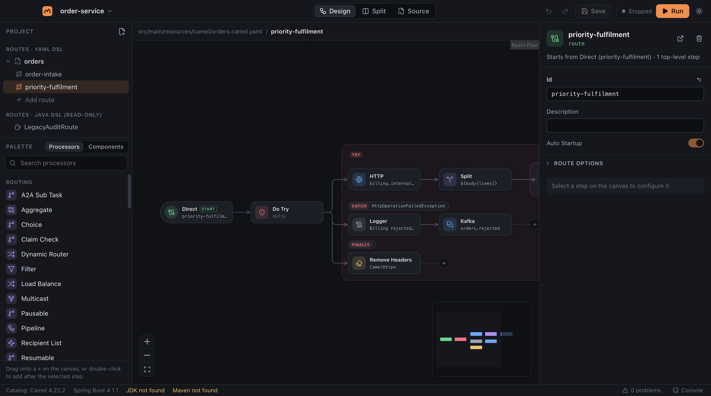
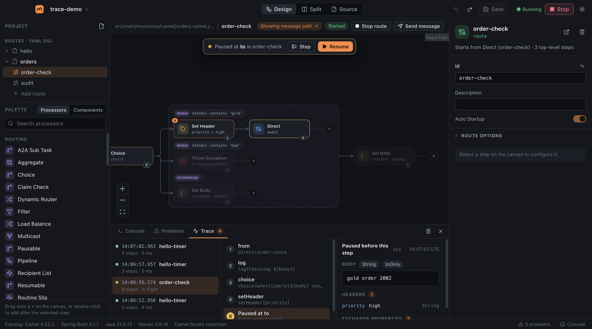
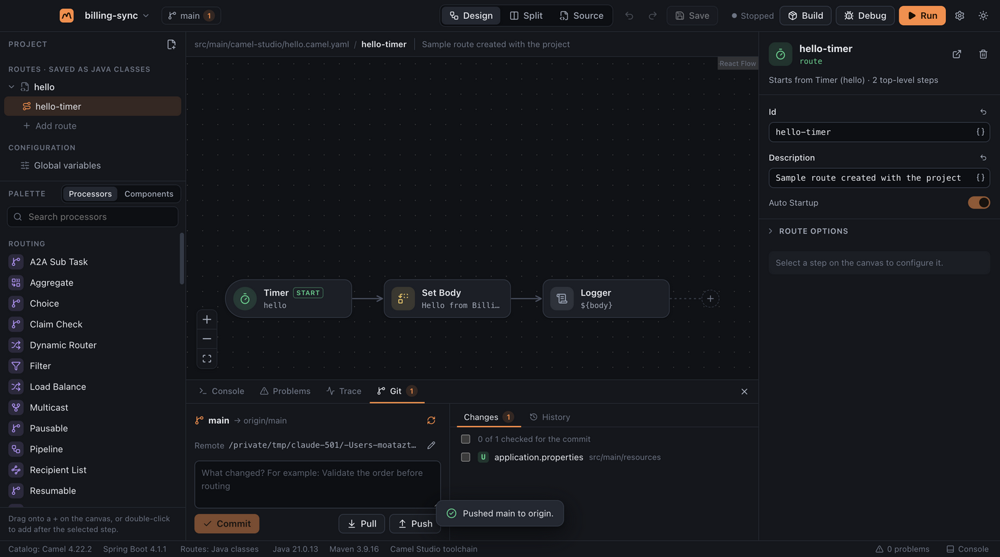
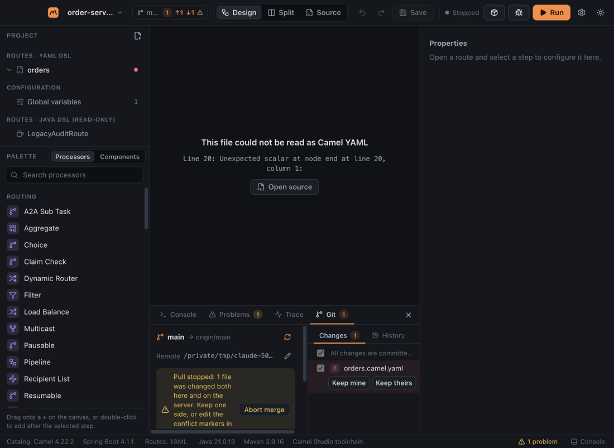
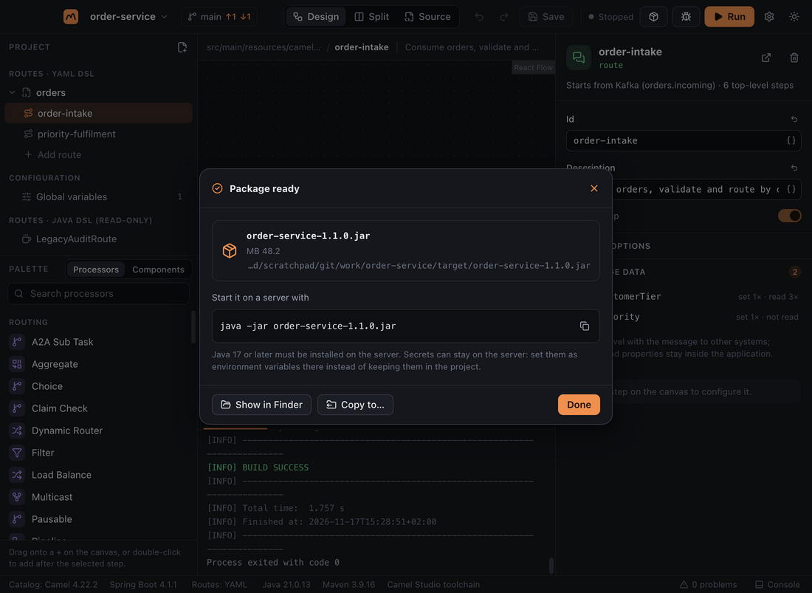
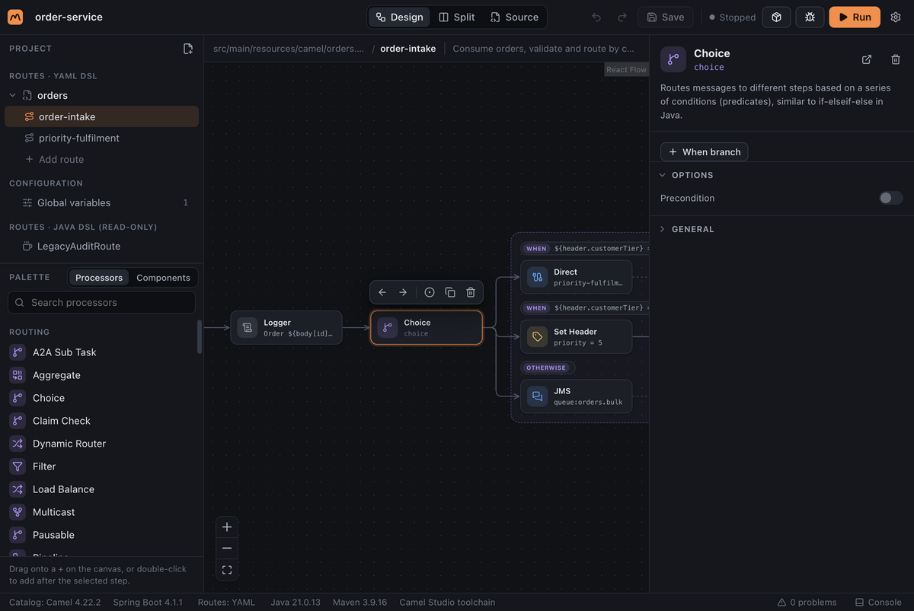
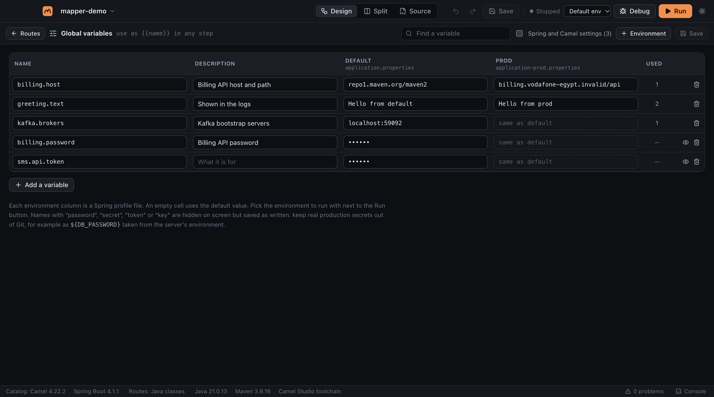
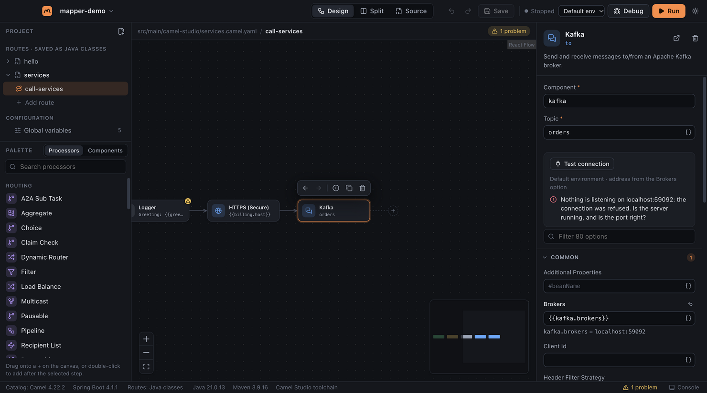
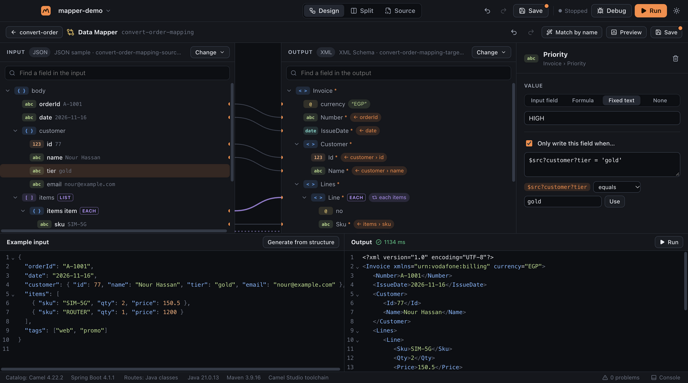

# Camel Studio

A desktop IDE for Spring Boot + Apache Camel integrations, built for teams moving off TIBCO BW5:
one place to design, run, deploy and operate routes. This repository is the first slice, the designer.



## Run it

```bash
npm install
npm run dev
```

`npm run build` followed by `npm start` runs the production build. Open `examples/order-service`
from the welcome screen to see a project with YAML routes and a Java DSL route.

Running a route from the IDE needs a JDK 21 and Maven. Camel Studio looks for them in this order:

1. `java` and `mvn` on your PATH (as seen by your login shell), or the project's Maven wrapper
2. Its own toolchain folder, `~/.camel-studio/toolchain/jdk` and `~/.camel-studio/toolchain/maven`

The second is a fallback for machines with no Java installed: unpack a JDK and a Maven there (or
symlink them) and nothing else on the machine needs to change. `CAMEL_STUDIO_TOOLCHAIN` points it
at a different folder.

## What works today

| Area | What it does |
|---|---|
| Projects | Create a Spring Boot + Camel project, or open any existing Maven project. Route files are discovered automatically. |
| Canvas | Routes drawn left to right with automatic layout. Choice, split, doTry, circuit breaker and other containers show their branches as lanes. |
| Palette | Every processor and all 401 components from the official Camel catalog. Drag onto a `+`, or use the quick-add search on the canvas. |
| Properties | Forms generated from the catalog: endpoint options grouped and filterable, expressions with a language picker, data formats, route options. |
| Source | Split and source views, kept in sync both ways. Selecting a step reveals it in the YAML. |
| Problems | Live validation: missing required options, empty expressions, unknown components, consumer-only components used as producers. |
| Save | Writes the YAML and adds the Camel Spring Boot starters the routes need to `pom.xml`. |
| Run | Starts the app with `spring-boot:run`, streams the log, and stops the whole process tree. Warns first if the routes have unresolved problems. |
| Live statistics | While the app runs, every step on the canvas shows how many messages passed through it and how many failed. |
| Trace | Every message is recorded step by step. Select one to see its path on the canvas and its body and headers at each step. |
| Test messages | Send a body and headers to any endpoint of the running app, and optionally wait for the reply. |
| Debug | Breakpoints on steps, then Step and Resume. The paused message is shown with its body, headers and history. |
| Route control | Stop and start a single route without restarting the app. |
| Settings | Java and Maven to use (with one-click install), Maven settings.xml, the Camel version (download and switch catalogs), new-project defaults, the team palette, and a team profile to share it all. |
| Step actions | Right-click a step: insert before/after, replace, enable/disable, duplicate, copy/cut/paste (⌘C/⌘X/⌘V, also between projects as YAML), breakpoint, save to the team palette, delete. Drag a step onto a + to move it. |
| Git | Clone from the welcome screen; a Git tab with changed files, diffs, commit, pull and push; the branch and what is waiting to push or pull in the title bar; conflicts settled with Keep mine / Keep theirs. Uses your own Git, SSH keys and credential manager. |
| Build package | Builds the deployable JAR with Maven (`mvn clean package`), sets its version, and shows how to start it on a server. Camel Studio's dev-only tools are never inside it. |
| VS Code extension | The same designer as a VS Code editor for `*.camel.yaml` files, with Run, Debug, Trace, Build package, the Data Mapper and Settings. Packaged as a `.vsix`. |
| Global variables | BW5-style global variables with one column per environment (dev, test, prod…). Stored as Spring property files; used in steps as `{{name}}`, with a picker and the resolved value shown under each field. |
| Environments | Choose the environment next to Run; the app starts with that Spring profile. |
| Test connection | On endpoint steps: checks the server answers (HTTP, Kafka, JMS/ActiveMQ/Artemis, databases via JDBC URL, FTP/SFTP, SMPP, mail, MongoDB, LDAP). |
| Message data | The route panel lists the headers, variables and properties each route sets and reads (BW5 process variables). Expressions get an Insert menu for these, global variables and common functions. |
| Data Mapper | Map one message onto another by drawing lines between fields. XML and JSON in any direction, from an XSD, a JSON Schema or an example message, with loops, formulas, fixed values, conditions and a live preview. |
| Java output | Each project chooses how routes are saved: YAML DSL, or standard Camel `RouteBuilder` Java classes generated from the visual design on every save. Tracing and debugging work in both. |
| Hand-written Java | Existing RouteBuilder classes are listed and shown read-only. |

Visual edits are applied to the YAML document tree rather than regenerating the file, so comments
and formatting written by hand survive.



## Settings (admin area)

The gear in the title bar (or Settings on the welcome screen) opens Camel Studio's own settings,
kept in `~/.camel-studio/settings.json`:

- **Java and Maven**: Automatic, a JDK/Maven found on the machine, or a folder you choose. Install
  JDK 21 or 17 (Eclipse Temurin from adoptium.net) and Maven 3.9 (Maven Central) in one click:
  checksums are verified and everything stays in `~/.camel-studio/toolchain`. A project's own
  Maven wrapper is still used for that project. A Maven `settings.xml` (company Nexus or proxy) is
  passed to every build with `-s`.
- **Camel version**: download the catalog of another Camel release (LTS lines are marked) and
  switch the designer to it. New projects use it with the Spring Boot version it is built for.
  When the open project uses another version, one click moves its `pom.xml` (only the
  `camel.version` property and the Spring Boot parent version change).
- **New projects**: default group ID, route format and Java version.
- **Team palette**: reusable processes (right-click a step, or a route's first step for all its
  steps, and choose "Save to the team palette") and team components (import the component's JAR:
  its Camel descriptor and Maven coordinates are read, it appears in the palette with its options,
  and `pom.xml` gets the dependency when a route uses it).
- **Team profile**: export everything above except machine paths into one JSON file, and import it
  on each developer's machine. Team component descriptors travel inside the file.

There is no access control: anyone can change their own settings, and the team profile is the way
to keep machines aligned.

## Git and packaging

For now the team deploys the usual way: commit and push from Camel Studio, and build the JAR the
servers run. Deploying and monitoring will be a separate application.



**Git.** The Git tab (bottom panel, or click the branch in the title bar) lists what changed since
the last commit. Click a file to see its diff, uncheck files to leave them out, write a message and
Commit (⌘↵). Pull and Push talk to the `origin` remote; the title bar shows how many commits wait in
each direction (refresh it with the fetch button). A project that is not in Git yet gets a Create
repository button and a field for the remote address; Clone repository on the welcome screen fetches
a project from the team's server and opens it.

- Camel Studio runs the Git installed on the machine with the user's own configuration: SSH keys,
  the credential manager (macOS Keychain, Windows Credential Manager) and the remotes as they are.
  When Git needs a user name, a password or access token, an SSH passphrase or a yes to a new server,
  Camel Studio shows the question and passes the answer to Git. It stores none of it.
- The first commit asks for a name and email once; they are saved in the user's Git settings.
- Unsaved edits are saved before a commit. Pulling waits until everything is saved, then reloads the
  routes that changed on disk.
- A pull that conflicts stops with the conflicting files marked. Keep mine or Keep theirs settles a
  file with one whole side; or edit the conflict markers in the source and save. Commit to finish, or
  Abort merge to go back to how things were before the pull.
- Only the project folder is shown and committed, so a project inside a larger repository stays
  separate.



**Build package.** Build (title bar) runs `mvn clean package` and produces the runnable Spring Boot
JAR in `target/`. Set the version first if needed (it is written to `pom.xml`), and choose whether
the tests run. The JAR holds the routes, their libraries and the global variables of every
environment; the environment is picked when it starts:

```
java -jar order-service-1.1.0.jar --spring.profiles.active=prod
```

The Camel Studio Maven profiles (CLI connector, debugger) are never part of this build. When it
finishes, Package ready offers Show in Finder, Copy to… a folder, and the start command for each
environment.



## VS Code extension



For developers who work in VS Code, the designer is also a VS Code extension. Opening any
`*.camel.yaml` file shows it on the canvas, with the same palette, inspector, Data Mapper, global
variables, Test connection, Run, Debug, Trace, Build package and Settings.

Build and install it:

```bash
npm run vscode
```

```bash
"/Applications/Visual Studio Code.app/Contents/Resources/app/bin/code" --install-extension dist/camel-studio-vscode-0.5.0.vsix
```

(or in VS Code: Extensions › ⋯ › Install from VSIX…). On Windows, `code --install-extension` with
the same file.

How it fits into VS Code:

- The route stays a VS Code document. Canvas edits mark the tab as modified; ⌘S (in the designer or
  from File › Save) saves it and does what a save does in the desktop app (Java class, `pom.xml`).
  Typing in a text editor, Revert File and Git checkouts update the canvas.
- *Open as Text* in the editor title switches to the text editor; a text editor of a route file has
  *Open in Camel Studio Designer*. *Reopen Editor With…* sets either as the default.
- *Camel Studio: New Route File* (also on a folder's right-click menu) creates a route in the
  project's route folder and opens it.
- Another route file picked in the designer's own explorer opens in its own tab; Java classes open as
  text.
- Settings (JDK, Maven, Camel version, team palette and components) are shared with the desktop app.
- Git stays with VS Code's Source Control view, so the designer has no Git tab there.

Inside, the extension runs the same UI bundle in a webview and the same backend (`src/main/backend.ts`)
in the extension host; only the shell differs (`src/vscode/extension.ts`, `src/vscode/bridge.ts`).

## Global variables and environments



**Configuration › Global variables** in the project panel opens a table of variables with one column
per environment. They are ordinary Spring Boot properties, so the project needs nothing extra at
run time:

| File | Holds |
|---|---|
| `src/main/resources/application.properties` | the default values |
| `src/main/resources/application-<env>.properties` | the values that differ in that environment (a Spring profile) |

Descriptions are written as comments above each entry; comments, blank lines and order written by
hand are kept. Spring and Camel framework settings are hidden unless "Spring and Camel settings" is
ticked. Names containing password, secret, token or key are masked on screen, but are saved as
written: keep production secrets out of Git, for example as `${DB_PASSWORD}` read from the server.

In steps, a variable is written `{{name}}` (Camel property placeholders). Every text field has a
`{ }` button to pick one, and shows what it resolves to in the selected environment. A variable no
environment defines is reported in Problems, because Camel would refuse to start. The environment
next to Run is passed as `-Dspring-boot.run.profiles`.

## Test connection



Endpoint steps that talk to a server have a **Test connection** button. The address is taken from
the endpoint, its options, or the matching Spring setting (for example `spring.datasource.url` for
SQL, `spring.artemis.broker-url` for JMS), with global variables resolved for the selected
environment. It opens a connection, sends an HTTP request or reads the server greeting for FTP, SFTP
and mail, and explains failures in plain words (refused, unknown host, timeout, untrusted
certificate). It does not log in: credentials are checked when the route runs.

## Data Mapper



Add a **Data Mapper** step from the palette (Transformation) or the quick-add menu; it opens a
full-screen mapper.

- **Describe both sides** with an XML Schema, a JSON Schema, or an example XML or JSON message
  (imported from a file or pasted). XSD root elements can be switched when a schema has several.
- **Drag fields** from the input onto the output. A structure dropped on a structure matches the
  fields inside by name; a list dropped on a list repeats the output once per item.
- **Per output field**: an input field, a formula (XPath 3.1, with a searchable function list), a
  fixed text, or a **conditional value** (when … then …, else when …, otherwise), plus an optional
  condition for writing the field at all, built from a field, an operator and a value.
- **Loops** can be **sorted** by one or more fields of the item, ascending or descending, as text
  or as numbers.
- **Headers, variables and exchange properties** can be added as inputs next to the body and
  mapped like any field. Camel passes them to the stylesheet by name; the preview takes an example
  value for each.
- **Copy** (XML to XML): the whole content of an input structure is copied into an output
  structure as it is, including elements the output schema does not declare.
- **Checks**: the overview lists required output fields that have no value, and mappings that
  point at fields no longer in the structures. The preview has an **XSLT** tab with the exact
  stylesheet Camel will run.
- **Live preview** runs the mapping on an example message with Saxon-HE 13.0, the engine Camel's
  `xslt-saxon` component uses, so the preview is what the route will produce. Saxon is taken from
  the local Maven cache or downloaded once from Maven Central into `~/.camel-studio/toolchain`.

What is written to the project:

| File | Content |
|---|---|
| `src/main/camel-studio/mappings/<name>.mapping.json` | The mapping, as edited in the mapper |
| `src/main/camel-studio/schemas/` | The structures it was built from |
| `src/main/resources/mappings/<name>.xsl` | The generated XSLT 3.0 stylesheet Camel runs |

In the route the step is a plain Camel `step` that calls `xslt-saxon:mappings/<name>.xsl`. For JSON
input it first moves the body into the exchange variable `CamelStudioSourceJson` (Camel passes
variables to stylesheets as parameters), because XSLT reads XML documents. If an earlier step
already parsed the JSON into a Java map or list, the step turns it back into JSON text first.
Saving adds `camel-xslt-saxon-starter` (and `camel-jackson-starter` for JSON input) to `pom.xml`.

Not supported: reading an existing hand-written XSLT file back into the mapper, and grouping
(`xsl:for-each-group`).

## Java output

New projects default to Java classes; the format can be switched any time from the status bar
("Routes: …").

| | YAML DSL | Java classes |
|---|---|---|
| Route files | `src/main/resources/camel/*.camel.yaml`, run by Camel | `src/main/camel-studio/*.camel.yaml`, the visual model only |
| What Camel runs | the YAML | `<base package>.routes.<Name>Routes`, a `@Component` RouteBuilder |
| Generated on | nothing is generated | every save, and when the project is opened |

The generated class is plain Camel Java DSL with no dependency on Camel Studio, so the project
builds and runs without the tool. Do not edit it by hand: edit on the canvas, and put custom
logic in your own beans or processors and call them with a Bean or Process step. Steps the
generator cannot express yet are listed in the Problems tab and left as a `// TODO` line.

The generator was checked against a test route that nests choice, split, filter, doTry with
catch and finally, multicast, loop and recipient list inside each other: the class compiles and
behaves the same as the YAML on Camel 4.22.2.

## Tracing and debugging

These features talk to the running app through Camel's own CLI connector, the mechanism behind
`camel trace` and `camel debug`. The app exchanges small JSON files with the IDE under `~/.camel/`,
so no HTTP or JMX port is opened.

They need two development-only Maven profiles in the project's `pom.xml`. New projects have them;
for an existing project the Trace tab offers to add them.

| Profile | Adds | Used by |
|---|---|---|
| `camel-studio` | `camel-cli-connector-starter` | Run and Debug: statistics, tracing, test messages, route control |
| `camel-studio-debug` | `camel-debug-starter`, `camel-seda-starter` | Debug only: breakpoints and stepping |

The profiles are only active when the app is started from Camel Studio, so normal builds and
deployed artifacts do not contain the tooling. If the `pom.xml` has profiles marked
`activeByDefault`, Camel Studio names them explicitly so they stay active.

Three things worth knowing:

- Steps are matched to the running app by source line, so live data is hidden for a file that was
  edited after launch. Restart the app to see it again.
- In Debug, test messages are queued through a small helper route (`camel-studio-send`) so that a
  message stopped at a breakpoint cannot freeze the tooling. The reply is not returned to the send
  dialog in that mode; follow the message in the Trace tab.
- A message paused at a breakpoint continues by itself after five minutes (Camel's default).

## How it is built

```
src/main        The backend shared by both shells (backend.ts): project scanning and scaffolding,
                pom.xml sync, Maven runner (runs and package builds), Git (git.ts, askpass.ts), the
                live link to the running app (runtime.ts). index.ts is the Electron shell.
src/vscode      The VS Code extension: custom editor and host (extension.ts), webview bridge
                (bridge.ts). Manifest and packaging folder: vscode/
src/preload     The typed bridge (window.studio) between UI and main process
src/shared      Types shared by both sides
src/renderer    React UI
  model/camel.ts    Route model: parsing, path-addressed edits, validation, catalog helpers
  model/layout.ts   Automatic left-to-right layout
  components/       Canvas, palette, inspector, source editor, console, trace and debug views
resources/catalog   Offline Camel catalog (generated)
scripts/build-catalog.mjs   Builds the catalog from the camel-catalog JAR on Maven Central
```

Three decisions shape the rest:

- **YAML is the source of truth.** There is no designer metadata and no stored layout. A route file
  opened in Camel Studio is the same file Camel runs, and it diffs cleanly in Git.
- **The catalog drives the UI.** No component or processor is hand-coded. Upgrading Camel is
  `npm run catalog <version>`.
- **The UI cannot touch the disk directly.** Every file operation goes through the main process and
  is confined to the open project folder.

To target another Camel version, set `camelStudio.camelVersion` in `package.json` and run
`npm run catalog`. The matching Spring Boot version is read from the Camel parent POM.

## Not built yet

- Deployment and monitoring of running apps: planned as a separate application
- Visual editing of Java DSL and XML DSL routes, REST DSL, beans, route templates
- Tracing and debugging for apps that are not started from the IDE (for example on a server)
- Git branches (create and switch) inside the app: use Git directly for those for now
